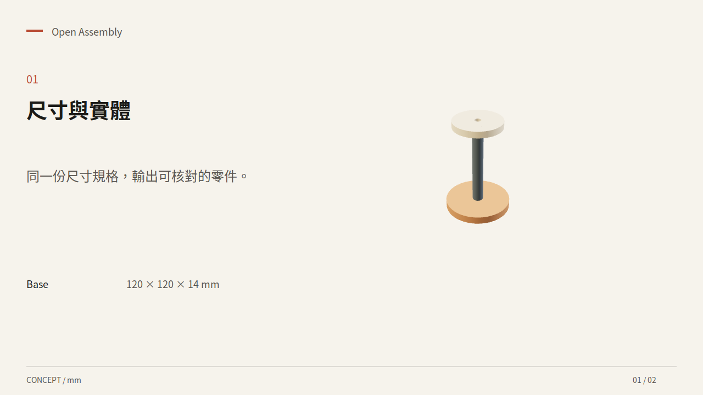

# Family Creative Studio · 暖紙造物台

Family Creative Studio（暖紙造物台）是一套運行於本機的宣告式多格式創作工作台。創作者與 AI 編碼代理（Claude Code、Codex、Cursor、Antigravity 等）可透過單一結構化專案母本（Manifest），將參數化 3D 實體、STEP 機構件、含材質與動畫的 GLB 場景、高解析圖片與影片、旁白音訊及可編輯 SVG，組裝為互動網頁、工程幾何、圖解、簡報與字幕影片。

**目前版本：0.3.0。** 本版擴充幾何建模、來源畫質、混音、原生簡報與編輯操作。研究的 12 個專案中，11 個有局部機制或資料被採用，VoiceStudio 列為研究來源；各項實作與下一步見 [與原專案的比較](docs/COMPARISON.md) 及 [實際來源與授權](THIRD_PARTY.md)。自動化驗證檢查檔案與行為；專業創作品質另需作品評審。



## 能做什麼

- **參數化 CAD 與精確預覽**：方塊、圓柱、球體、圓錐、圓環、多邊形擠出與 STEP 匯入，支援旋轉、全邊圓角／倒角及空間布林運算。OpenCASCADE 產生 STEP／STL／GLB，交叉核驗體積與邊界；等距向量圖取自實際網格。
- **高保真媒體匯入與敘事影片**：保留上傳的原始位元組，使用來源畫布／幀率，或指定 720p／1080p／2160p 與最高 60 fps。支援 HDR 至 SDR 色調映射、字幕、原音與旁白混音、音量與淡入淡出、雙趟響度正規化；章節完成一次 H.264 合成後，以串流複製串接。
- **原生可編輯簡報**：支援的 SVG 轉為 PowerPoint 原生圖形與文字框，輸出 `presentation.pptx`，並嵌入章節影片、旁白、備註、自動換頁與淡入動畫。自訂 SVG 的畫布、縮放與繼承字型樣式會納入轉換。
- **保留原作的 3D 場景**：匯入自含資源的 GLB，保留材質、紋理、階層、骨架與動畫資料；選擇一段動畫搭配環繞／分解鏡頭。GLB 視覺場景與參數 CAD 各有明確的來源記錄。
- **連動編輯與代理操作**：尺寸代幣保留原始模板並即時預覽，提供草稿復原、版本比對與修訂衝突保護。CLI、HTTP 與 **19 項 MCP 工具**共用專案、素材及佇列；時間軸匯入可先預覽差異。
- **圖解與設計檢視**：支援 11 種 Archify 圖表資料、Impeccable 稽核結果定位、兩種 WebGPU 背景效果與靜態 CSS 退路。文字對比度在渲染前檢查；快取重用前驗證輸入、引擎及產物雜湊。

外部生成模型採匯入協作：本機 `eSpeak NG` 提供離線草稿對時，專業配音、生圖、圖片重建 3D 與藝術資產可由外部工具產出標準檔案後接入。GLB 保留原作；工程 STEP／STL 由獨立 CAD 組件產生。網頁提供互動 3D，PPT 嵌入影片並保留支援的向量與文字，MP4 為平面 SDR 影片。下一階段涵蓋草圖約束、局部特徵建模、多動畫混合、語音時間戳剪輯及更多簡報版型。

## 快速開始

渲染端以 **Ubuntu 24.04、Linux x86_64** 為目標。MacBook／Windows 可作為瀏覽器操作端；MacBook 也可保留輕量程式 checkout，經 SSH 連接 Linux 渲染端。安裝腳本會檢查 Linux 平台；原生 macOS／Windows 完整渲染屬後續移植範圍。

先準備 Git、Node.js 22+／npm，以及 Python 3.11。若有 `uv`，安裝腳本會用它建立 Python 3.11 虛擬環境；否則使用 `python3.11`，也可設定 `PYTHON_BIN` 指向該版本。Ubuntu 24.04 不一定提供 `python3.11-venv`，可使用 `uv` 管理 Python；有提供此套件的發行版則可自行安裝。

Ubuntu 系統依賴：

```bash
sudo apt-get update
sudo apt-get install -y git ffmpeg espeak-ng bubblewrap libcairo2 libsndfile1 fonts-noto-cjk
```

另外安裝 Chrome 或 Chromium。程式會尋找可用的瀏覽器執行檔，必要時指定路徑：

```bash
export STUDIO_BROWSER=/usr/bin/chromium
```

執行檔名稱存在不代表沙箱一定可運作：渲染需要 Linux 允許 Bubblewrap 建立使用者／網路／PID 命名空間。遇到限制請使用支援此能力的開發環境，保留系統保護設定。詳見 [安全與執行邊界](docs/SECURITY.md)。

```bash
git clone https://github.com/aidanhearth/family-creative-studio.git
cd family-creative-studio
./setup.sh
.venv/bin/family-studio serve
```

開啟 **http://127.0.0.1:8765/**。`setup.sh` 會安裝鎖定版本的 Python／npm 依賴、建立前端、下載兩個固定 commit 的必要來源，最後執行環境檢查；不會自行安裝系統套件。首次安裝需要網路，渲染子程序停用網路，且不需要付費模型金鑰。

介面提供三種起始專案：產品解說、組裝敘事、素材故事。素材故事仍需自行匯入素材；範本不包含商業影音或模型權重。

## 使用方式與設定

CLI 與 MCP 都可使用相同的母本、版本與工作佇列。完整操作範例見 [代理快速上手](docs/AGENT-QUICKSTART.md)，程式結構與開發命令見 [AGENTS.md](AGENTS.md)。

```bash
.venv/bin/family-studio doctor
.venv/bin/family-studio create assembly_story my-assembly
.venv/bin/family-studio preflight my-assembly
.venv/bin/family-studio render my-assembly --targets diagram cad slides --wait
```

成功工作會回傳 `output_dir`；渲染失敗則保留工作狀態，不把排隊視為完成。

| 環境變數 | 預設 | 用途 |
|---|---|---|
| `STUDIO_DATA` | 專案內 `.state` | 私人專案、素材、版本、快取與產物 |
| `STUDIO_SOURCES` | 專案內 `.sources` | 固定版本的上游來源 |
| `STUDIO_BROWSER` | 自動尋找 | Chrome／Chromium 執行檔 |
| `PYTHON_BIN` | `python3.11` | 未安裝 `uv` 時，首次建立虛擬環境使用的 Python |

`.env.example` 是設定參考；程式**不會自動載入 `.env`**。請在啟動前 `export` 所需變數。工作資料與下載的來源預設不進 Git。若要額外下載全部 12 個研究來源：

```bash
.venv/bin/python scripts/bootstrap_sources.py --all
```

此命令不下載模型權重或 Git LFS 大型素材，也不代表安裝了各原專案的完整執行環境。

## Using with Codex

Codex 可先讀 [AGENTS.md](AGENTS.md)，再透過 CLI 或 [MCP stdio 設定](docs/AGENT-QUICKSTART.md#mcp-stdio) 操作。Claude Code、Cursor 與 Antigravity 等支援 stdio MCP 的客戶端也可使用同一入口；各客戶端的設定檔位置與欄位依其版本調整。

## 開發與貢獻

```bash
.venv/bin/python -m pytest -q
npm test
npm run build
```

目前沒有獨立 lint 命令。合成驗收涵蓋實際 CAD／影片／原生簡報輸出、來源 4K／60 fps、原始 GLB 保留、動畫選擇與瀏覽器編輯；另已在 Apple M5 Metal 瀏覽器檢查 3D 幾何。完整數據、重現命令與測試範圍見 [驗證紀錄](docs/VERIFICATION.md)，Fable／Gemini 讀碼意見的核對與處置見 [合併修復結論](docs/REVIEW-RESOLUTION.md)。修改範圍與提交說明見 [CONTRIBUTING.md](CONTRIBUTING.md)。

## 授權

本專案原創程式採 [MIT](LICENSE)。研究來源包含 MIT、Apache-2.0、雙重授權及 VoiceStudio 的 AGPL-3.0-only；VoiceStudio 僅供選擇性下載研究，本專案未包含或執行其程式。保留的授權、NOTICE、固定 commit 與實際採用範圍見 [THIRD_PARTY.md](THIRD_PARTY.md) 與 `vendor/`。
